# Flutter_App — Aplicativo de prática de partitura com feedback em tempo real

Aplicativo Flutter do TCC **Sistema de Processamento de Áudio com Feedback em Tempo Real Aplicado ao Ensino de Partitura**.

O aluno toca a partitura exibida no app; o [dispositivo embarcado](https://github.com/noggyamamoto/firmware_I2S) (ESP32 + microfone INMP441) identifica as notas tocadas e as envia ao app, que compara cada nota com a partitura **MusicXML** e mostra o resultado na hora: verde para acerto, amarelo para aproximado e vermelho para erro, como nos aplicativos de prática musical (Simply Piano, Yousician, Meludia).

### Novidades desta versão: sem atraso no início, no meio da execução e no feedback

| Feature (commit) | O que mudou |
|---|---|
| **Execução sem atraso** (`execucao-sem-atraso`) | **Áudio contínuo:** contagem de entrada, metrônomo e música guia num único arquivo (`SessionAudioPlan`); antes, a música era outro arquivo, que começava atrasado pelo ciclo da lógica (até 30 ms), pela partida do player e pelo relógio da sessão (o dispositivo conta a partir do recebimento do comando). Os cliques caem nos instantes e tempos fortes das batidas do dispositivo; um novo arquivo só entra quando o andamento muda. O áudio é conferido com o relógio da sessão e realinhado se passar de 30 ms. **Lógica no ritmo da tela:** troca de trecho, destaque da próxima nota e notas perdidas vistos no quadro em que acontecem. **"Perdeu" no tempo da rede:** a espera usa o maior atraso medido nas últimas notas + 80 ms (150–350 ms) em vez de 350 ms fixos. **Feedback imediato:** metrônomo visual, número da contagem e nota tocada aparecem no quadro da batida/nota, sem animação de entrada. Com o firmware 1.3.3, a nota sai do dispositivo ~35 ms mais cedo (média) |

### Navegação fluida, sem travamentos

| Feature (commit) | O que mudou |
|---|---|
| **Tela de execução fluida** (`tela-de-execucao-fluida`) | O cursor da partitura, o metrônomo visual, a contagem de entrada e o tempo decorrido são atualizados a cada quadro da tela por um relógio ao vivo (`PerformanceLiveClock`), redesenhando só o widget de cada valor. Antes a tela inteira era reconstruída a cada 30 ms (e a partitura inteira repintada); agora o estado muda só quando algo visível muda (~7 vezes por segundo, contra ~33). O metrônomo visual é calculado pelo relógio da sessão com a mesma contagem do dispositivo, sem engasgar com o atraso irregular dos pacotes da rede. O diagnóstico enviado pelo dispositivo a cada segundo não reconstrói mais a tela |
| **Metrônomo sonoro sem atraso** (`metronomo-sonoro-sem-atraso`) | Síntese dos cliques e da música guia ~10 vezes mais rápida (mesmo som), em isolate no celular/computador e em etapas no navegador. Dois players se alternam: o próximo trecho é carregado enquanto o atual toca e começa na hora. A contagem de entrada é gerada e carregada assim que a música fica pronta, e o primeiro clique sai junto com o INICIAR. Na web, o áudio vai ao player por blob URL (antes, data URI em base64 na thread da tela) |
| **Inicialização e navegação rápidas** (`inicializacao-e-navegacao-rapidas`) | Abertura exibida na hora (no navegador, já no HTML) enquanto o Firebase inicia, em vez de tela em branco; a sessão salva no navegador é restaurada sem passar pela tela de login; preferências, repertório e músicas recentes carregados durante a conexão com o dispositivo; partituras interpretadas fora da thread da interface e guardadas em cache (reabrir uma música é instantâneo) |

### Versão anterior

| Feature (commit) | O que mudou |
|---|---|
| **Avaliação sem erros falsos** (`avaliacao-sem-erros-falsos`) | Com o dispositivo real, a nota certa tocada no tempo certo era contada como erro: o app marcava a nota como perdida antes de o evento chegar pela rede (confirmação da altura + Wi-Fi, 100–300 ms) e depois recusava a nota atrasada como "extra". Agora a nota só é perdida após a janela + 350 ms de entrega, e uma nota que chega atrasada (com o instante de ataque do dispositivo dentro da janela) substitui a "perdida" |
| **Descoberta automática do dispositivo** (`descoberta-automatica-do-dispositivo`, feature `device_discovery`) | O app encontra o dispositivo sozinho na mesma rede, também no navegador: endereços já usados, `partitura.local` (mDNS), `192.168.4.1` e varredura da sub-rede |
| **Log da execução no console** (`log-da-execucao-no-console`, feature `execution_log`) | Durante a execução o console do navegador mostra as notas esperadas (C4, B6...) e as figuras (semínima, colcheia, fusa...) e o que foi captado pelo microfone; as notas esperadas também vão para o monitor serial do dispositivo |
| **Metrônomo sonoro com o dispositivo** (`metronomo-sonoro-com-dispositivo`) | O metrônomo do app toca também com o dispositivo conectado (antes, só no modo demonstração), com um estalo sem altura que o microfone não confunde com nota |

---

## Sumário

1. [Visão geral](#1-visão-geral)
2. [Funcionalidades e requisitos](#2-funcionalidades-e-requisitos)
3. [Plataformas](#3-plataformas)
4. [Arquitetura](#4-arquitetura)
   - 4.1 [Camadas](#41-camadas)
   - 4.2 [Estrutura de diretórios](#42-estrutura-de-diretórios)
   - 4.3 [Módulos](#43-módulos)
   - 4.4 [Diagramas de classes](#44-diagramas-de-classes)
5. [Fluxos de funcionamento](#5-fluxos-de-funcionamento)
6. [Renderização da partitura](#6-renderização-da-partitura)
7. [Interface de execução e feedback](#7-interface-de-execução-e-feedback)
8. [Partituras MusicXML](#8-partituras-musicxml)
9. [Como executar](#9-como-executar)
10. [Testes](#10-testes)
11. [Firestore](#11-firestore)
12. [Créditos e licenças](#12-créditos-e-licenças)

---

## 1. Visão geral

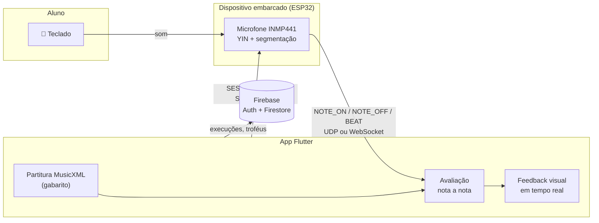

| Item | Descrição |
|---|---|
| Framework | Flutter 3 (Dart 3) |
| Estado | Riverpod 3 (`Notifier`/`Provider`) |
| Backend | Firebase Authentication e Cloud Firestore |
| Partituras | MusicXML (`.musicxml`, `.xml`, `.mxl` compactado) |
| Notação | Motor de gravação próprio com a fonte SMuFL **Bravura** |
| Comunicação | UDP (Android, iOS, desktop) e WebSocket (web) com o protocolo binário do firmware |

---

## 2. Funcionalidades e requisitos

| Requisito (TCC) | Funcionalidade | Onde |
|---|---|---|
| **RFA01** / RU02 – Pareamento | Busca automática (broadcast UDP, endereços já usados, `partitura.local`, varredura da sub-rede – também no navegador), conexão pelo IP, heartbeat, modo demonstração | `features/connection`, `features/device_discovery` |
| **RFA02** / RU03 – Catálogo | Repertório por dificuldade (fácil, médio, difícil) com busca | `features/songs` |
| **RFA03** / RU04–RU06 – Configuração | Música guia, metrônomo sonoro e visual, tamanho dos trechos, ampliação | `features/configuration` |
| **RFA04** / RU08 – Partitura adaptada | Trechos curtos, símbolos ampliados, ajuste à tela | `features/score/presentation/notation` |
| **RFA05** / RU07 – Compassos de entrada | Contagem de 2 compassos sincronizada com o metrônomo do dispositivo | `performance` (`CountdownWidget`) |
| **RFA06** / RU10 – Cores em tempo real | Verde = acerto, amarelo = aproximado, vermelho = erro/nota perdida, com selo sobre a nota | `performance`, `score_painter.dart` |
| **RFA07** – Avaliação por frase | Altura e ritmo calculados ao término de cada trecho | `performance_evaluator.dart` |
| **RFA08** / RU11 – Interrupção < 50 % | Tela de incentivo com "Repetir trecho" | `performance_page.dart` |
| **RFA09** / RU12 – Redução de BPM | Sugestão ou ajuste automático de −10 % | `performance_provider.dart` |
| **RFA10** / RU13 / RU15 – Pontuação e troféus | Precisão, estrelas, conceito (A+ a F) e troféus | `performance_result_page.dart`, `features/gamification` |
| **RFA11** / RU14 – Evolução | Gráfico de linha a partir da 10ª execução da mesma música | `performance_chart.dart` |
| RU16 / RU17 – Reiniciar e desconectar | Tocar novamente e desconexão segura | resultado / conexão |
| **RNFA01** – Portabilidade | Android, iOS, Web, Windows, macOS e Linux com layout responsivo | todo o app |
| **RNFA02** – Comunicação assíncrona | WebSocket na web e UDP nativo, sem bloquear a interface | `connection/data/transport` |

---

## 3. Plataformas

| Plataforma | Comunicação com o dispositivo | Descoberta | Observações |
|---|---|---|---|
| Android / iOS | UDP (porta 54322) | Broadcast ou IP | iOS pede permissão de rede local (`NSLocalNetworkUsageDescription`) |
| Windows / macOS / Linux | UDP (porta 54322) | Broadcast ou IP | — |
| Web (Chrome, Edge, Firefox, Safari) | WebSocket `ws://IP/ws` | Automática: IPs já usados, `partitura.local`, `192.168.4.1` e varredura das sub-redes comuns; ou IP informado | Servir o app por `http://` (páginas `https://` bloqueiam `ws://`) |
| Todas | Modo demonstração | — | Um "aluno virtual" toca a partitura com pequenos erros, sem hardware |

O layout se adapta ao tamanho da tela (ver [seção 7](#7-interface-de-execução-e-feedback)): celular em pé, celular deitado, tablet e navegador/desktop.

---

## 4. Arquitetura

### 4.1 Camadas

Cada funcionalidade (`features/*`) segue a **Clean Architecture** em três camadas, com dependências apontando para o domínio:

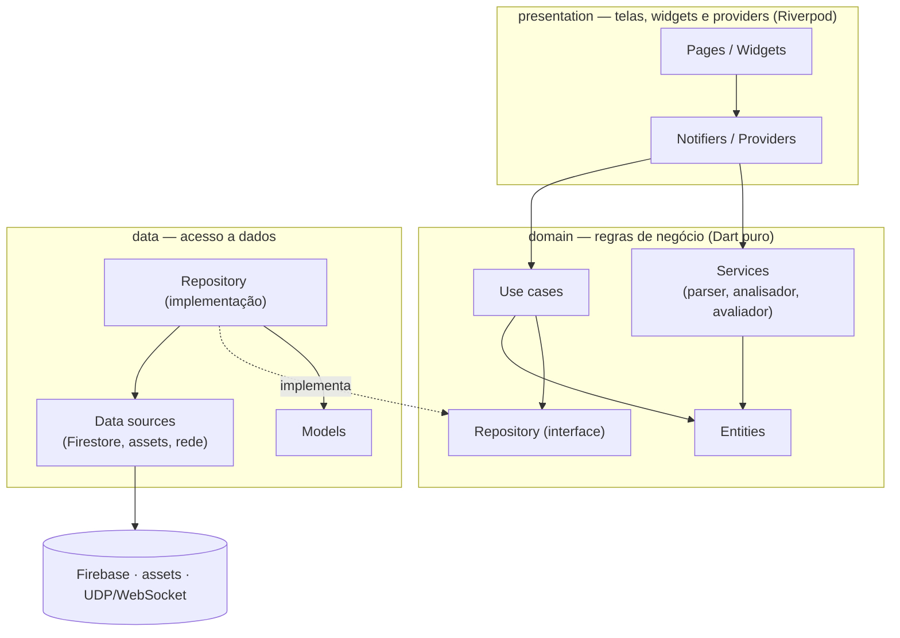

### 4.2 Estrutura de diretórios

```text
flutter_app/
├── assets/
│   ├── fonts/Bravura.otf              # fonte musical SMuFL (OFL)
│   ├── midi/                          # áudio guia (MIDI)
│   └── partituras/                    # partituras MusicXML do repertório
├── lib/
│   ├── main.dart                      # inicialização (Firebase + ProviderScope)
│   ├── core/theme/app_colors.dart     # identidade visual (cores e feedback)
│   └── features/
│       ├── auth/                      # login, cadastro, perfil
│       ├── connection/                # dispositivo: protocolo, transporte UDP/WebSocket, simulador
│       ├── device_discovery/          # onde procurar o dispositivo (mDNS, IPs já usados, sub-redes)
│       ├── execution_log/             # log da execução no console (esperado x captado)
│       ├── songs/                     # repertório (Firestore)
│       ├── configuration/             # preferências da execução
│       ├── score/                     # partitura: parser MusicXML, frases, avaliação, notação
│       │   └── presentation/notation/ # motor de gravação (SMuFL/Bravura)
│       ├── performance/               # tela de execução, HUD, metrônomo, resultado
│       ├── history/                   # histórico de execuções
│       └── gamification/              # troféus
├── test/                              # testes de unidade, widgets, renderização e integração
├── tools/midi_to_musicxml.py          # conversão de MIDI para MusicXML (music21)
├── web/ android/ ios/ windows/ macos/ linux/
└── pubspec.yaml
```

### 4.3 Módulos

| Módulo | Responsabilidade | Principais classes |
|---|---|---|
| `auth` | Autenticação (Firebase Auth) e perfil | `AuthNotifier`, `AuthGate`, `LoginPage` |
| `connection` | Descoberta, pareamento, heartbeat, eventos do dispositivo, simulador | `ConnectionNotifier`, `ConnectionRepositoryImpl`, `DeviceProtocol`, `UdpTransport` |
| `device_discovery` | Endereços da busca automática e histórico dos endereços pareados | `DiscoveryTargets`, `KnownDevicesStore` |
| `execution_log` | Log da execução no console: notas esperadas e captadas com nome (C4) e figura (semínima) | `ExecutionConsoleLog`, `NoteNaming` |
| `songs` | Catálogo de músicas por dificuldade | `SongsPage`, `Song` |
| `configuration` | Preferências (música guia, metrônomo, trechos, zoom) | `ConfigurationNotifier`, `PerformanceSettings` |
| `score` | Leitura do MusicXML, frases, melodia avaliada, avaliação e renderização | `MusicXmlParser`, `ScoreAnalyzer`, `PerformanceEvaluator`, `ScoreEngraver` |
| `performance` | Execução em tempo real, HUD, feedback, áudio guia, resultado | `PerformanceNotifier`, `PerformancePage`, `ScoreDisplay` |
| `history` | Execuções salvas e evolução | `HistoryRepository`, `PerformanceChart` |
| `gamification` | Troféus e progresso | `CheckTrophies`, `GamificationPage` |

### 4.4 Diagramas de classes

#### a) Domínio da partitura

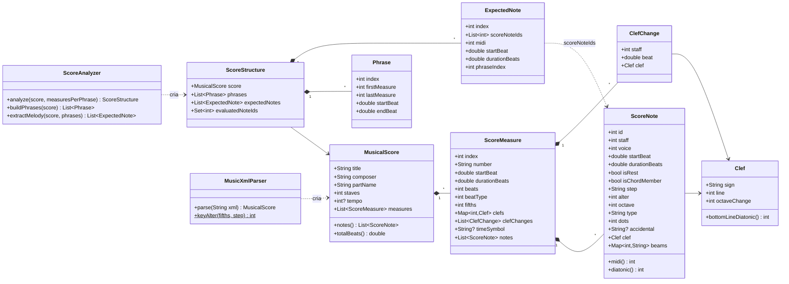

#### b) Renderização da partitura

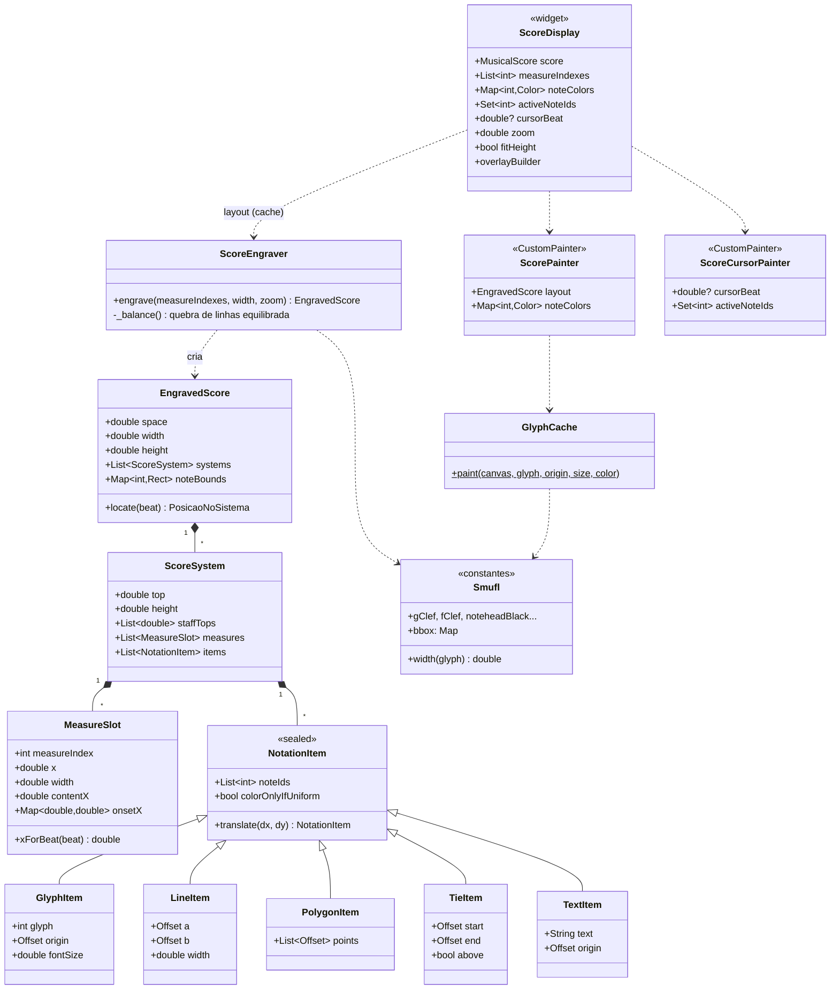

#### c) Execução, avaliação e comunicação

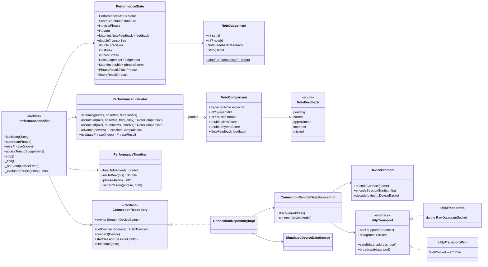

> `UdpTransportIo` e `UdpTransportWeb` correspondem a `udp_transport_io.dart` e `udp_transport_web.dart`, escolhidos por importação condicional (`dart.library.io`).

---

## 5. Fluxos de funcionamento

### 5.1 Navegação

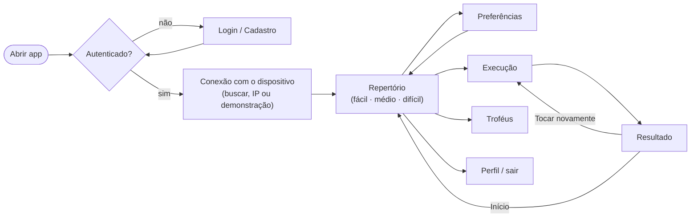

### 5.2 Carregamento da partitura

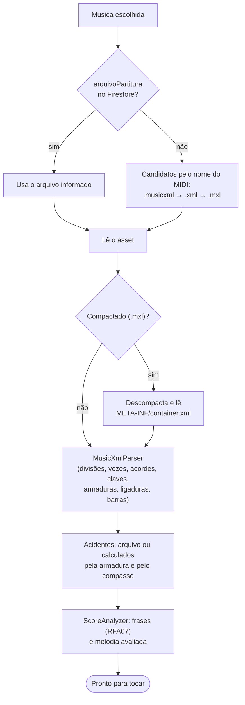

### 5.3 Execução e feedback em tempo real

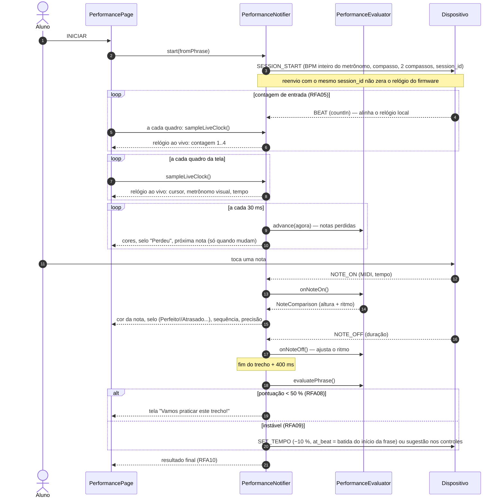

#### Sincronismo do BPM com o firmware

- O metrônomo do dispositivo bate na unidade de tempo do compasso (em 6/8, a colcheia) com um **BPM inteiro**. O app envia esse valor no `SESSION_START` e calcula a contagem e o horário de cada nota com **o mesmo inteiro** (`PerformanceTimeline.metronomeBpmFor`). Antes, a linha do tempo usava o BPM em semínimas e, em 2/2 a 75 BPM (37,5 → 38), a partitura se afastava ~170 ms do clique a cada 8 tempos.
- O `SESSION_START` leva um `session_id`. Se a primeira batida não chega e o comando é reenviado, o firmware ignora a repetição em vez de zerar o relógio de novo; batidas de uma execução anterior são descartadas.
- O `SET_TEMPO` informa a batida (`at_beat`, contagem incluída) em que o novo andamento começa. Ele é enviado no momento em que a redução é decidida e reenviado meio tempo antes da frase; o firmware troca o BPM exatamente na batida do início da frase, mesmo que o pacote chegue antes ou que o primeiro envio se perca.
- As notas são avaliadas pelo carimbo de tempo do próprio dispositivo; o relógio local só posiciona o cursor e é alinhado pela menor latência observada nas batidas.
- Como o evento de uma nota chega ao app 100–300 ms depois do ataque (confirmação da altura no dispositivo + rede), uma nota só é marcada como perdida depois da janela de avaliação **mais** `deliveryLatencyMs` (350 ms); se ainda assim o evento chegar depois, a nota "perdida" é substituída pela tocada, sem contar nota extra. O primeiro `session_id` é aleatório, para não coincidir com uma execução ainda ativa no dispositivo depois de recarregar o app.
- O metrônomo sonoro do app toca também com o dispositivo conectado; nesse caso o clique é um estalo sem altura definida (`ClickSound.wood`), que o microfone não confunde com nota. O áudio começa no ponto em que a sessão está, alinhado às batidas do dispositivo.
- O metrônomo visual não depende da chegada de cada `BEAT`: o tempo no compasso é calculado pelo relógio da sessão (`PerformanceTimeline.metronomeBeatAt`), com a mesma contagem do firmware (contagem de entrada e, depois, as batidas de cada frase no andamento dela). As batidas recebidas servem para alinhar o relógio.

#### Fluidez da tela e do áudio

| Onde | Como |
|---|---|
| Cursor, metrônomo visual, contagem, tempo | `PerformanceLiveClock` (`ValueNotifier`s) atualizado a cada quadro por um `Ticker` da tela; o cursor é redesenhado pelo `ScoreCursorPainter` (`repaint`), sem reconstruir widgets |
| Estado da execução | Atualizado só quando algo visível muda; cores das notas e destaque memorizados (a camada das notas não é repintada à toa) |
| Áudio | Síntese por osciladores recursivos (isolate / etapas na web); um único arquivo por execução (contagem + música), gerado e carregado antes do INICIAR; conferência da posição a cada 1,5 s e na primeira batida (realinha acima de 30 ms); troca de arquivo só na mudança de andamento, pré-carregada no outro player; blob URL na web |
| Lógica da execução | Rodada a cada quadro pela tela (`onFrame`) e, sem quadros, a cada 30 ms |
| Notas perdidas | Espera = janela + maior atraso medido nas últimas 12 notas + 80 ms (150 a 350 ms); nota que chega depois ainda substitui a "perdida" |
| Abertura | Tela de abertura imediata (HTML na web) enquanto o Firebase inicia; sessão restaurada sem piscar o login; repertório pré-carregado |
| Partituras | Interpretação em isolate e cache por arquivo |

#### Log da execução no console

Durante a execução, o console (no navegador: **F12 › Console**) mostra, no relógio do dispositivo (0 ms = primeira batida da contagem):

```
[Execução] Início: 100 BPM (metrônomo 100), compasso 4/4, contagem de 2 compasso(s) = 4800 ms (dispositivo). ...
[Esperado] #0    C4   semínima                 t=  4800 ms  dur  600 ms
[Captado ] C4   261.7 Hz                       t=  4810 ms  → Perfeito! (esperado #0 C4, +10 ms)
[Captado ] C4   solta: semínima                t=  5380 ms  dur 570 ms
[Esperado] #1    D4   colcheia                 t=  5400 ms  dur  300 ms
[Captado ] E4   329.6 Hz                       t=  5420 ms  → Nota errada (esperado #1 D4, +20 ms)
[Perdida ] #2    B6   fusa                     t=  5700 ms  (não foi captada)
[Trecho  ] 1: 62% (altura 50%, ritmo 75%) – 1/3 corretas, 1 perdidas, 0 extras
[Execução] Concluída: geral 62.0%, ...
```

As mesmas notas esperadas são enviadas ao dispositivo (`EXPECTED_NOTE`) antes de cada trecho e aparecem no monitor serial ao lado das notas captadas.

### 5.4 Avaliação de uma nota

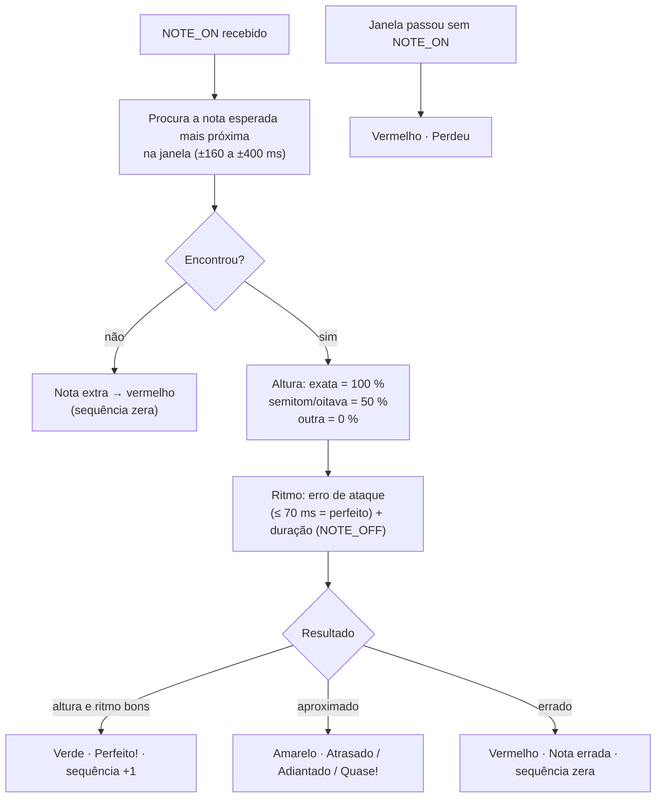

### 5.5 Conexão com o dispositivo

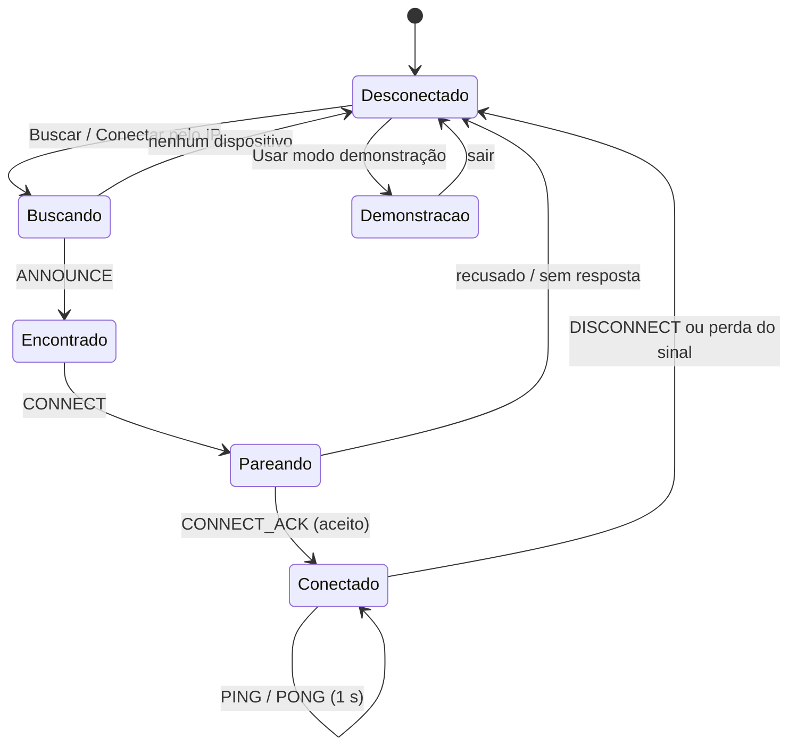

---

## 6. Renderização da partitura

A partitura é desenhada por um **motor de gravação próprio** (`lib/features/score/presentation/notation`), que funciona igualmente no celular, no desktop e na web (CanvasKit), sem WebView.

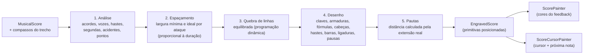

| Aspecto | Como é tratado |
|---|---|
| Símbolos | Fonte **SMuFL Bravura**: cada glifo é posicionado pela sua origem na linha de referência (linha da clave, centro da cabeça), sem ajustes manuais por fonte |
| Claves | Sol, fá e dó em qualquer linha, claves com transposição de oitava (8vb/8va) e mudanças de clave no meio do compasso |
| Armadura e fórmula | Sustenidos/bemóis na posição correta de cada clave, fórmula numérica ou símbolos C e ¢ |
| Vozes | Duas vozes na mesma pauta com hastes opostas; vozes que colidem são deslocadas |
| Acordes | Cabeças deslocadas em intervalos de segunda, linhas suplementares compartilhadas, acidentes empilhados em colunas |
| Acidentes | Do arquivo (`<accidental>`) ou calculados pela armadura e pelos acidentes já usados no compasso |
| Barras de colcheia | Agrupamento do arquivo, inclinação limitada, barras secundárias e ganchos; direção comum ao grupo |
| Ligaduras | Curvas com espessura variável, inclusive entre sistemas |
| Pausas | Todas as figuras, pausas de compasso inteiro centralizadas e posição por `<display-step>` |
| Cores | Todas as notas em preto; somente o feedback muda a cor (sem notas "cinza") |
| Tamanho | Ajuste à altura disponível (mínimo legível de 6,5 px por espaço); abaixo disso a partitura rola até o sistema do cursor |
| Desempenho | Layout calculado uma vez por trecho/tamanho; durante a execução apenas cores e cursor são redesenhados (camadas `RepaintBoundary` e cache de glifos) |

Os testes de renderização percorrem todo o repertório em várias larguras e verificam que nenhum elemento sai da área visível (ver [seção 10](#10-testes)).

---

## 7. Interface de execução e feedback

A tela de execução segue o padrão dos aplicativos de prática musical, mantendo a identidade visual do protótipo (fundo escuro `#0F0E17`, superfícies `#1E1B2E` e destaque violeta `#7C5CFA`).

```text
┌───────────────────────────────────────────────┐
│ ✕  Alecrim                       ● Conectado  │  barra superior
│    Trecho 3 de 10 · 4/4                       │
│ ▰▰▰▰ ▰▰▰▰ ▰▰▱▱ ▱▱▱▱ ▱▱▱▱ …                    │  progresso por trecho (cor = resultado)
│  (82%)     🔥 6       100       00:42         │  HUD: precisão · sequência · BPM · tempo
│ PRECISÃO  SEQUÊNCIA   ●○○○      TEMPO         │        (metrônomo visual nos pontos)
│ ┌───────────────────────────────────────────┐ │
│ │  partitura do trecho                       │ │  notas verdes/amarelas/vermelhas,
│ │   ♩ ♩ ♪♪  [Perfeito!]  │ ← cursor          │ │  selo sobre a nota avaliada,
│ │                        (próxima nota)      │ │  halo na próxima nota
│ └───────────────────────────────────────────┘ │
│ ┃Próxima nota: Ré 5  ┃Você tocou: Dó 5        │  guia da nota
│ ▕▏▕▏▕█▏▕▏▕▏▕▏▕█▏▕▏                            │  teclado (esperada = violeta, tocada = cor do feedback)
│ 6 notas tocadas                     [■ PARAR] │  controles (ou "Reduzir para 81 BPM")
└───────────────────────────────────────────────┘
```

| Elemento | Comportamento |
|---|---|
| Progresso por trecho | Um segmento por frase; o atual mostra o avanço do cursor e os concluídos ficam verdes (≥ 80 %), amarelos (≥ 50 %) ou vermelhos |
| Precisão | Anel animado com a precisão parcial, colorido pela faixa |
| Sequência | Acertos consecutivos; destaque a partir de 5 |
| Selo da nota | "Perfeito!", "Atrasado", "Adiantado", "Quase!", "Nota errada", "Perdeu" ou "Nota extra", animado sobre a nota |
| Cursor | Linha vertical que acompanha o tempo; a próxima nota recebe um halo violeta |
| Guia | Próxima nota esperada e última nota tocada, com teclado de referência |
| Resultado do trecho | Sem aviso sobre a partitura (cobria o início do trecho seguinte): a porcentagem aparece na cor do segmento do progresso por trecho |
| Andamento reduzido (RU12/RFA09) | Com ajuste automático, o BPM do HUD fica âmbar com uma seta ↓ quando o trecho mais lento começa; no ajuste manual, o botão "Reduzir para N BPM" substitui o contador de notas nos controles, abaixo da partitura |
| Trecho reprovado | Tela de incentivo com anel da pontuação, altura, ritmo, notas perdidas e "Repetir trecho" |
| Resultado final | Estrelas, mensagem de incentivo, precisão, notas tocadas, conceito (A+ a F), maior sequência, altura/ritmo por trecho e evolução |

| Tamanho de tela | Disposição |
|---|---|
| Celular em pé | Barra superior, progresso, HUD, partitura, guia com teclado, controles |
| Celular deitado (altura < 520 px) | HUD resumido na barra superior; partitura ocupa o restante |
| Tablet | Igual ao celular, com partitura maior |
| Web / desktop (largura ≥ 900 px) | Partitura à esquerda; painel lateral com HUD, guia e controles |

---

## 8. Partituras MusicXML

As partituras ficam em `flutter_app/assets/partituras/`. São aceitos arquivos exportados diretamente por editores (Flat, MuseScore, Finale, Sibelius, Dorico):

| Formato | Extensão |
|---|---|
| MusicXML partwise | `.musicxml` ou `.xml` |
| MusicXML compactado | `.mxl` |

Para associar a partitura a uma música, preencha `arquivoPartitura` no documento da coleção `partituras` do Firestore. Sem esse campo, o app procura um arquivo com o mesmo nome do `arquivoMidi`, nesta ordem: `.musicxml`, `.xml`, `.mxl`.

**Melodia avaliada.** O microfone reconhece uma nota por vez; por isso a avaliação usa a **melodia** (nota mais aguda de cada ataque da pauta superior, com ligaduras somadas). As demais notas aparecem normalmente na partitura, em preto.

**Adicionar uma partitura nova:**

1. Exporte do editor como MusicXML (`.musicxml` ou `.mxl`) e copie para `assets/partituras/`.
2. Cadastre a música no Firestore (`titulo`, `compositor`, `nivelDificuldade`, `bpmPadrao`, `arquivoMidi`, `arquivoPartitura`).
3. Rode `flutter test test/score` — o teste de renderização verifica o novo arquivo automaticamente.

Para converter um MIDI em MusicXML de piano (pauta dupla):

```bash
pip install music21
python tools/midi_to_musicxml.py assets/midi/minha_musica.mid --out assets/partituras
```

---

## 9. Como executar

```bash
cd flutter_app
flutter pub get

flutter run                 # dispositivo/emulador conectado (Android, iOS)
flutter run -d chrome       # navegador
flutter run -d windows      # ou macos / linux
```

Compilação para distribuição:

```bash
flutter build apk           # Android
flutter build ios           # iOS (macOS + Xcode)
flutter build web           # Web (servir a pasta build/web por http://)
```

Sem o hardware, use **"Usar modo demonstração"** na tela de conexão: um aluno virtual toca a partitura com pequenos erros, em qualquer plataforma.

A busca é automática ao abrir a tela de conexão: o app consulta os endereços em que o dispositivo já foi encontrado, `partitura.local` (anunciado pelo firmware por mDNS), `192.168.4.1` (rede própria do dispositivo) e, se nada responder, a sub-rede inteira – na **web**, sem broadcast, as sub-redes mais comuns de modems domésticos (pode levar até 1 minuto). Se a rede usar uma faixa de IP incomum, informe o IP exibido no topo do menu serial (ou `partitura.local`) em "Conectar pelo IP".

---

## 10. Testes

```bash
cd flutter_app
flutter analyze
flutter test
```

| Suíte | Arquivo | O que verifica |
|---|---|---|
| Parser MusicXML | `test/score/musicxml_parser_test.dart` | Atributos, vozes, acordes, ligaduras, acidentes calculados, claves, `.mxl`, todo o repertório |
| Renderização | `test/score/score_render_test.dart` | Todo o repertório em 5 larguras: nenhum elemento fora da área, todas as notas posicionadas, desenho sem exceções |
| Avaliação | `test/score/performance_evaluator_test.dart` | Linha do tempo e avaliação nota a nota/por frase; nota certa que chega atrasada pela rede não vira erro |
| Fluxo de execução | `test/performance/performance_flow_test.dart` | Música inteira com o dispositivo simulado (inclusive com as notas chegando 300 ms depois do ataque), reprovação de trecho, redução automática de BPM (sem avisos sobre a partitura), sequência, notas por trecho e log no console; fluidez: menos de 12 atualizações de estado por segundo e metrônomo visual igual às batidas do dispositivo; metrônomo sonoro num único áudio com cliques nos instantes e tempos fortes das batidas do dispositivo (também após mudança de BPM); player que começa 120 ms atrasado é realinhado; início da música visto no quadro em que acontece; "Perdeu" mais cedo com rede rápida e só em notas não tocadas, e espera máxima com rede lenta |
| Síntese de áudio | `test/performance/audio_synth_test.dart` | Síntese otimizada igual à fórmula original (A0 a C8), trecho de 8 s em menos de 40 ms, síntese em etapas igual à direta |
| Áudio no navegador | `test/performance/web_audio_source_test.dart` | WAV entregue ao player por blob URL (`flutter test --platform chrome`) |
| Abertura | `test/startup_test.dart` | Tela de abertura enquanto o Firebase inicia; falha com "Tentar novamente" |
| Cache de partituras | `test/score/score_cache_test.dart` | Partitura lida uma vez, erros fora do cache, `FormatException` preservada vinda do isolate |
| Log da execução | `test/performance/execution_log_test.dart` | Nomes (C4, B6) e figuras, linhas do console, pacotes `EXPECTED_NOTE` e `beat_type` |
| Metrônomo | `test/performance/metronome_click_test.dart` | Clique do dispositivo audível e sem altura definida |
| Descoberta | `test/connection/device_discovery_test.dart` | Varredura no navegador, prioridade do último endereço, histórico |
| Sincronismo | `test/performance/performance_timeline_sync_test.dart`, `test/connection/session_sync_test.dart` | BPM inteiro do metrônomo na linha do tempo (4/4, 6/8, 2/2), batida do metrônomo no instante (contagem, mudança de andamento, após o fim), `session_id` mantido no reenvio, batidas antigas descartadas, `at_beat` do `SET_TEMPO` |
| Telas | `test/performance/performance_screens_test.dart` | Tela de execução em celular, celular deitado, tablet e web: pronta, em execução e com sugestão de BPM (nada sobre a partitura) |
| Widgets | `test/widget_test.dart` | Partitura em todas as frases/larguras, cursor ao vivo sem reconstruir a partitura, metrônomo visual aceso no quadro da batida, conexão, HUD e tela de incentivo |
| Integração UDP | `test/connection/udp_device_test.dart` | Protocolo contra o dispositivo falso do firmware |
| Integração WebSocket | `test/connection/websocket_device_test.dart` | App web (Chrome) contra o dispositivo falso via WebSocket |

Capturas para conferência visual:

```bash
SCORE_RENDER_DIR=build/score_renders flutter test test/score/score_render_test.dart
SCREENSHOT_DIR=build/screens flutter test test/performance/performance_screens_test.dart
```

Integração com o dispositivo falso (repositório `firmware_I2S`):

```bash
make -C MicroDetection/test/host fake_device
FAKE_DEVICE=/caminho/fake_device flutter test test/connection/udp_device_test.dart

./MicroDetection/test/host/fake_device &
python3 MicroDetection/test/host/ws_bridge.py 80 &
flutter test --platform chrome --dart-define=WS_DEVICE=true test/connection/websocket_device_test.dart
```

---

## 11. Firestore

| Coleção | Campos |
|---|---|
| `usuarios/{uid}` | `id`, `nome`, `email`, `dataCriacao` e `trofeus` — mapa `idTrofeu → {idTrofeu, idPartitura, dataConquista}` com as conquistas |
| `partituras` | `titulo`, `compositor`, `nivelDificuldade` (fácil/médio/difícil), `bpmPadrao`, `arquivoMidi`, `arquivoPartitura` (opcional) |
| `execucoes` | `idUsuario`, `idPartitura`, `dataHora`, `status`, `bpmInicial`, `bpmFinal`, `pontuacaoFinal`, `pontuacaoAltura`, `pontuacaoRitmo`, `notasTocadas`, `notasCorretas` |
| `trofeus` (opcional) | `titulo`, `descricao`, `icone`, `criterio`, `meta` — sem regra de leitura (ou vazio), o app usa o catálogo padrão |

As regras de segurança do projeto estão em [`flutter_app/firestore.rules`](flutter_app/firestore.rules) e o app foi ajustado a elas:

| Regra | Consequência no app |
|---|---|
| `usuarios/{userId}`: só o próprio documento | As conquistas ficam no campo `trofeus` do documento do usuário (gravadas com `merge`). A subcoleção `usuarios/{uid}/trofeus` usada antes caía na regra final (`allow read, write: if false`) e a tela de troféus falhava com *permission-denied* |
| `execucoes`: leitura só com `idUsuario == uid` | Toda consulta filtra por `idUsuario` |
| Demais coleções bloqueadas | O catálogo `trofeus` não é lido; vale o catálogo padrão do app |

A aba **Evolução** consultava `execucoes` com dois filtros de igualdade e `orderBy('dataHora')`, combinação que exige um índice composto inexistente no projeto (*FAILED_PRECONDITION*). A consulta agora usa só as igualdades e ordena no app. Depois de salvar a execução, o progresso dos troféus é recalculado; uma falha na verificação dos troféus não é mais reportada como falha ao salvar a execução.

Verificação das regras no emulador (Firebase CLI + `@firebase/rules-unit-testing`): caminho antigo dos troféus negado; campo `trofeus` com `merge` permitido e preservando o perfil; consultas de execuções por usuário e por música permitidas; consulta sem filtro de usuário e escrita em nome de outro usuário negadas.

---

## 12. Créditos e licenças

- Fonte musical [Bravura](https://github.com/steinbergmedia/bravura) (Steinberg Media Technologies), padrão [SMuFL](https://www.smufl.org/), licenciada sob a SIL Open Font License 1.1 — `flutter_app/assets/fonts/OFL-Bravura.txt`.
- Código do aplicativo: ver [`LICENSE`](LICENSE).
